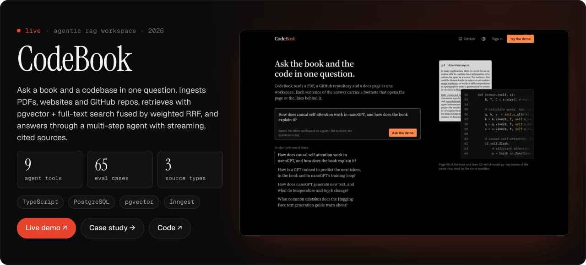
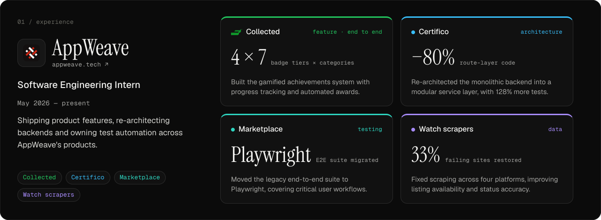
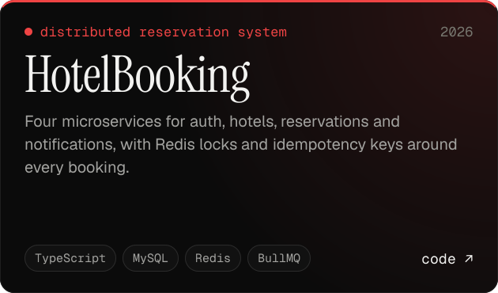
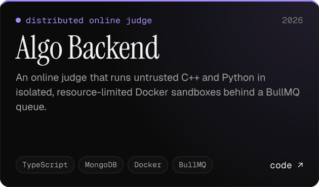
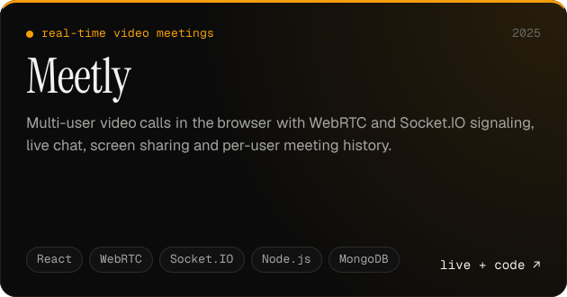
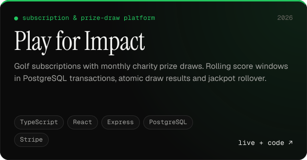
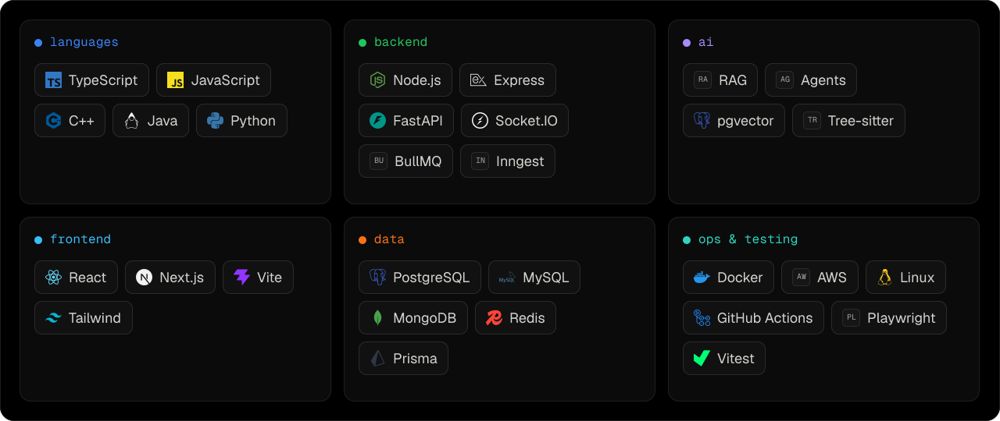

  
  
  
  
  
  

I'm a Software Engineering Intern at [AppWeave](https://appweave.tech) and a B.Tech CSE student at IIIT Nuzvid (2024–2028). I build backend systems, AI agents with RAG, and full stack products, and I'm a Knight on LeetCode.

 

### Building now

[Live demo](https://codebook.girishthedecent.space/) · [Case study](https://girishthedecent.space/projects/codebook) · [Code](https://github.com/girishthedecent/codebook)

 

### Experience

 

### Selected work

  
  
  
  

Live: [Meetly](https://meetly.girishthedecent.space/) · [Play for Impact](https://play-for-impact.vercel.app)

### More projects

| Project | What it is | Stack |
| --- | --- | --- |
| [AI Voice Sales Agent](https://github.com/girishthedecent/ai-voice-sales) | Voice agent that qualifies leads as hot, warm or cold and sends tiered WhatsApp follow-ups through validated mid-call tools. | TypeScript, Express, Zod, Docker |
| [Task API](https://github.com/girishthedecent/Take-Home-Assignment-The-Untested-API) | Test suite and prioritised bug report for a previously untested Express API, with a new endpoint built test-first. | Node.js, Express, Jest |
| [URL Shortener](https://github.com/girishthedecent/url_shortener) | Type-safe short-link service with tRPC, MongoDB and Redis. | TypeScript, tRPC, MongoDB, Redis |
| [Contact App](https://github.com/girishthedecent/contact-app) | MERN contact manager with validation and environment-specific CORS. | React, Vite, Express, MongoDB |
| [Backend Starters](https://github.com/girishthedecent/ts-backend-starter) | Reusable TypeScript and Express service templates. | TypeScript, Express, MongoDB |
| [GitHub-Inspired Platform](https://github.com/girishthedecent/github) | Repos, profiles, ownership and access control, built system-first. | Node.js, Express |
| [Airbnb-style App](https://github.com/girishthedecent/airbnb) | Listings, reviews and auth with an MVC architecture. | Node.js, Express |

All 12 projects, with descriptions: **[girishthedecent.space/projects](https://girishthedecent.space/projects)**

 

### Activity

  
  

 

### Stack

 

Activity cards refresh daily through GitHub Actions. More at <a href="https://girishthedecent.space">girishthedecent.space</a>.
